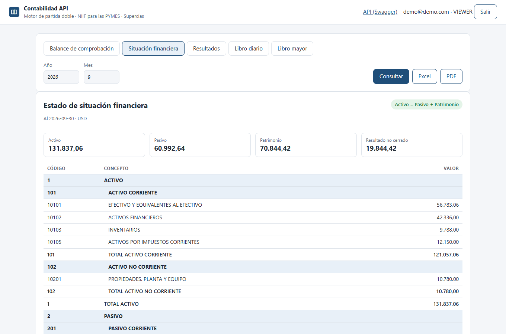
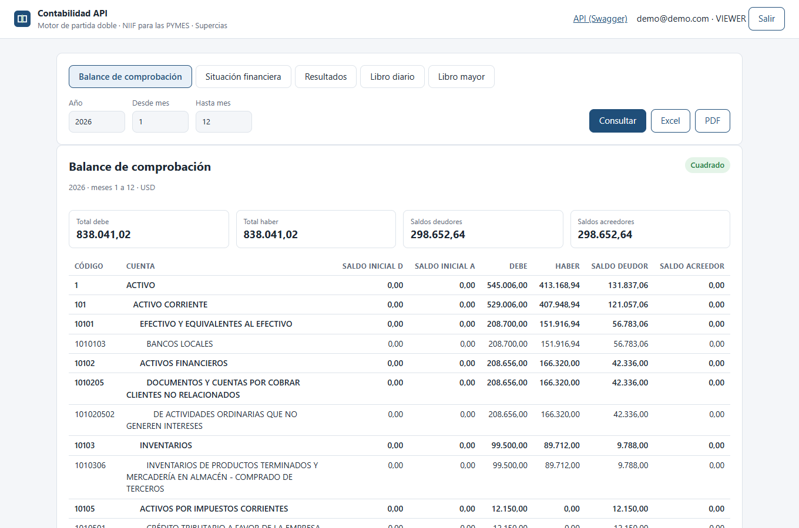
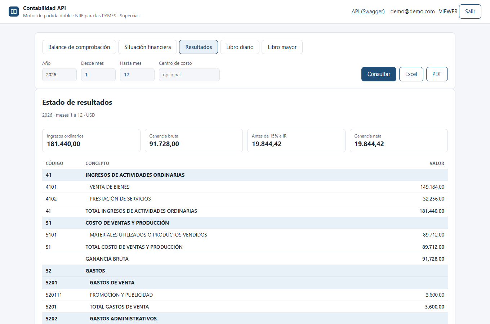
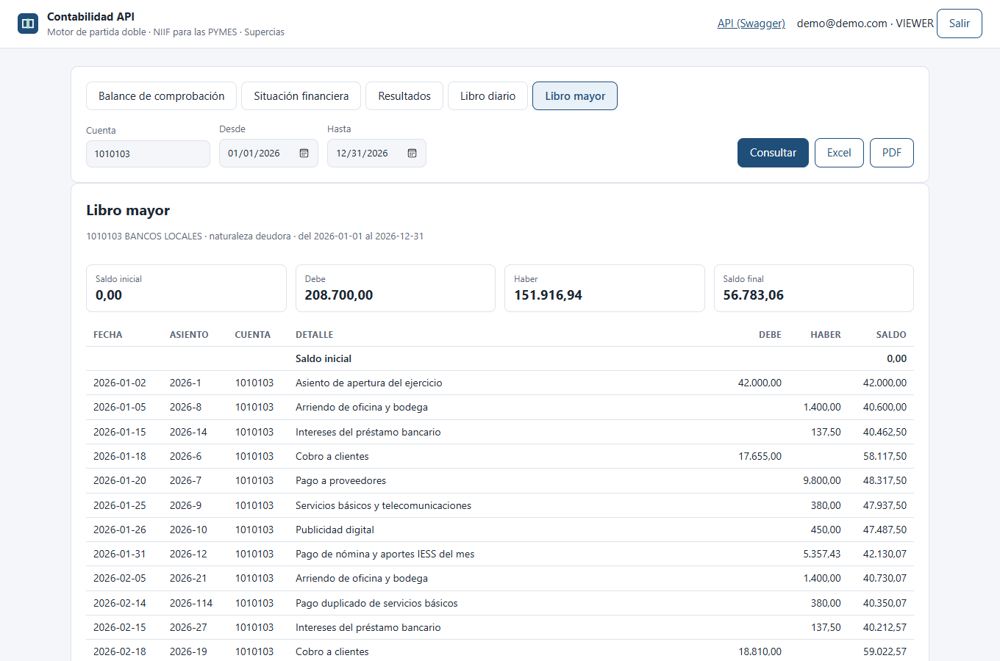
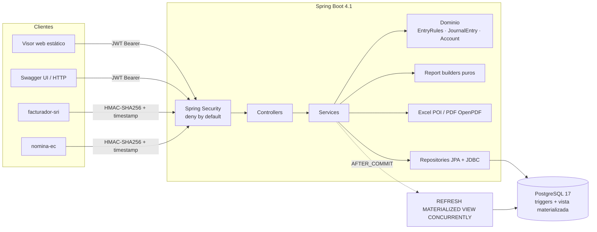
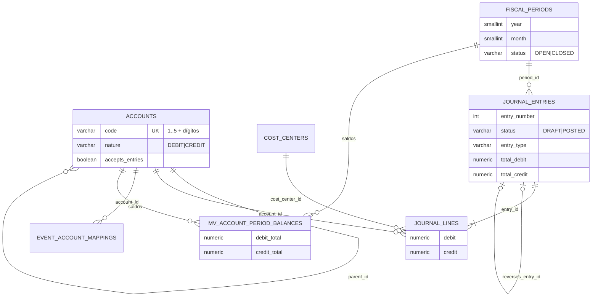

# contabilidad-api

Motor de contabilidad por partida doble para PYMES ecuatorianas: plan de cuentas de la Supercias, asientos que **no se guardan si no cuadran**, periodos que se cierran de verdad y estados financieros NIIF para las PYMES exportables a Excel y PDF.

[](https://github.com/DiegoFranciscoG/contabilidad-api/actions/workflows/ci.yml)


**Demo en vivo:** se publica en Render + Neon siguiendo [docs/despliegue.md](docs/despliegue.md) · **Usuario de prueba:** `demo@demo.com` (rol lector, sin permisos de escritura; su contraseña es la que se configure en `DEMO_PASSWORD`). El plan gratuito de Render se duerme a los 15 min: la primera carga tarda ~1 minuto.



| Balance de comprobación | Estado de resultados | Libro mayor |
|---|---|---|
|  |  |  |

## Problema que resuelve

En Ecuador toda sociedad lleva contabilidad por **partida doble, en castellano y en dólares** (LORTI art. 20) y presenta a la Supercias estados financieros bajo NIIF. Las hojas de cálculo no impiden un asiento descuadrado ni la edición de un mes ya declarado. Esta API hace cumplir esas reglas en el dominio **y** en la base de datos, y genera los libros y estados financieros con la estructura del catálogo oficial, listos para Excel o PDF.

## Funcionalidades

- **Plan de cuentas jerárquico** sembrado desde el catálogo de la Supercias (1 activo … 5 costos y gastos), con naturaleza deudora/acreedora, cuentas correctoras y cuentas de grupo que no aceptan movimientos. **Importación desde CSV** (todo o nada).
- **Asientos** en borrador o contabilizados, numeración correlativa por año sin huecos, centro de costo por línea. Un asiento solo se guarda si **debe = haber** (validación de dominio + trigger diferido en PostgreSQL).
- **Periodos mensuales** que se cierran en orden y **nunca se reabren**; los errores se corrigen con **asiento de reverso** en un periodo abierto (NIIF PYMES 10.21).
- **Cierre del ejercicio**: asiento automático que salda ingresos y gastos contra 30701 / 30702.
- **Reportes**: libro diario, libro mayor con saldo acumulado, balance de comprobación de sumas y saldos, estado de situación financiera (corriente / no corriente) y estado de resultados por función con los subtotales del formulario Supercias. Todos en **JSON, XLSX y PDF**; resultados filtrables por centro de costo.
- **Asientos automáticos por eventos** de `facturador-sri` (factura emitida) y `nomina-ec` (nómina aprobada), firmados con HMAC e idempotentes.
- **Visor web** mínimo y Swagger UI.

## Arquitectura



Capas: `controller` → `service` (+ `service/report`, `service/export`, `service/integration`) → `domain` → `repository`, con `dto`, `mapper`, `exception`, `security` y `config`.

## Stack y por qué

| Capa | Tecnología | Motivo |
|---|---|---|
| Backend | Java 25 (LTS) + Spring Boot 4.1.1 | Se pidió Spring Boot 3, pero la línea 3.x dejó de recibir parches OSS el 30-06-2026; 4.1 es la versión estable actual (ver decisión D-01) |
| Seguridad | Spring Security 7 + OAuth2 Resource Server (JWT HS256), Bucket4j + Caffeine | Tokens cortos sin sesiones, rate limiting acotado en memoria |
| Base de datos | PostgreSQL 17 + Flyway | Triggers diferidos para debe = haber, vista materializada para saldos, migraciones versionadas |
| Reportes | Apache POI 5.5, OpenPDF 3.0 | Excel nativo con celdas tipadas y PDF sin servicios externos |
| Tests | JUnit 6, jqwik 1.10, Testcontainers 2, JaCoCo | Propiedades sobre la ecuación contable y pruebas contra PostgreSQL real |
| Front | HTML + JS sin framework | El enunciado permite "Swagger + reportes"; un visor sin build cumple CSP estricta |
| DevOps | Docker multi-stage, GitHub Actions, Render + Neon | Todo gratis y reproducible con `docker compose up --build` |

## Modelo de datos

Detalle, restricciones y fuente de cada regla en [docs/modelo-datos.md](docs/modelo-datos.md); fuentes en [docs/investigacion.md](docs/investigacion.md).



## Ejecutar en local

**Con Docker** (levanta PostgreSQL, migra, crea el admin y carga la empresa demo ficticia):

```bash
cp .env.example .env        # completa los valores; genera secretos con: openssl rand -base64 48
docker compose up --build   # API y visor en http://localhost:8080 (cambia APP_PORT si el puerto está ocupado)
```

**Sin Docker** (Java 25 y un PostgreSQL 17 propio):

```bash
docker compose up -d db     # o tu propio PostgreSQL con la base "contabilidad"
set -a; . ./.env; set +a    # exporta las variables del .env en tu shell
./mvnw spring-boot:run
```

## Variables de entorno

| Variable | Descripción | Obligatoria |
|---|---|---|
| `DB_URL` | URL JDBC (`jdbc:postgresql://host:5432/contabilidad`; en Neon agrega `?sslmode=require`) | Sí |
| `DB_USER` / `DB_PASSWORD` | Credenciales de la base de datos | Sí |
| `JWT_SECRET` | Secreto HS256, mínimo 32 bytes; sin él la app no arranca | Sí |
| `INTEGRATION_HMAC_SECRET` | Secreto compartido con facturador-sri y nomina-ec, mínimo 32 bytes | Sí |
| `CORS_ALLOWED_ORIGINS` | Orígenes permitidos separados por coma (se rechaza `*`) | Sí |
| `ADMIN_EMAIL` / `ADMIN_PASSWORD` | Primer administrador (12+ caracteres); obligatorios en compose | Compose |
| `DEMO_DATA` / `DEMO_PASSWORD` | Carga la empresa ficticia y el usuario lector `demo@demo.com` | No |
| `APP_PORT` | Puerto local publicado por compose (8080) | No |
| `PORT`, `JWT_TTL`, `DB_POOL_SIZE`, `LOGIN_ATTEMPTS_PER_MINUTE`, `PUBLIC_API_DOCS` | Ajustes con valores seguros por defecto (8080, 15 min, 5, 5, true) | No |

## API

Swagger UI: `http://localhost:8080/swagger-ui.html` · OpenAPI: `/v3/api-docs` · Ejemplos listos en [docs/api.http](docs/api.http).

| Método | Ruta | Rol | Descripción |
|---|---|---|---|
| POST | `/api/v1/auth/login` | público | JWT de 15 min (5 intentos/min por IP y por correo) |
| GET / POST / PATCH | `/api/v1/accounts` | lector / contador | Plan de cuentas; `POST /import` (admin) importa CSV |
| GET / POST / PATCH | `/api/v1/cost-centers` | lector / contador | Centros de costo |
| POST | `/api/v1/fiscal-years/{year}/periods` | admin | Abre los 12 periodos del año |
| POST | `/api/v1/fiscal-periods/{year}/{month}/close` | admin | Cierra un periodo (en orden, sin borradores) |
| POST | `/api/v1/fiscal-years/{year}/closing-entry` | admin | Asiento de cierre del ejercicio |
| GET / POST / PUT / DELETE | `/api/v1/journal-entries` | lector / contador | Buscar, crear, editar y borrar borradores |
| POST | `/api/v1/journal-entries/{id}/post` · `/reverse` | contador | Contabilizar · reversar |
| GET | `/api/v1/reports/{journal,ledger,trial-balance,balance-sheet,income-statement}` | lector | `format=JSON\|XLSX\|PDF` |
| POST | `/api/v1/integrations/{invoices,payrolls}` | HMAC | Asientos automáticos (201 creado, 200 ya procesado) |
| GET / PUT | `/api/v1/event-account-mappings` | admin | Cuentas usadas por los asientos automáticos |
| GET / POST / PATCH | `/api/v1/users` | admin | Usuarios y roles |

Errores en formato RFC 9457 (`application/problem+json`): 400 validación, 401/403 acceso, 404, 409 conflicto, **422 regla contable**, 429 límite de intentos.

## Tests y cobertura

```bash
./mvnw verify   # unitarios + propiedades (jqwik) + integración (Testcontainers) + JaCoCo ≥ 70 %
```

- **Criterio de aceptación**: `AccountingEquationProperties` genera cientos de conjuntos aleatorios de asientos balanceados (incluidas cuentas correctoras) y comprueba que siempre se cumple Activo = Pasivo + Patrimonio + (Ingresos − Gastos), que la comprobación cuadra, que el resultado neto coincide entre estados y que todo asiento descuadrado se rechaza. `AccountingEquationIT` repite la propiedad de extremo a extremo contra PostgreSQL.
- `DatabaseRulesIT` escribe SQL directo para probar que los triggers bloquean lo que el dominio ya bloquea.
- `ReportServiceIT` cuadra a mano un ejercicio completo (apertura, venta, costo, depreciación, reverso y cierre).
- `ApiSecurityIT` y `ApiFlowIT` prueban JWT, roles, rate limiting, HMAC, CORS, cabeceras y descargas.
- 101 tests. Cobertura de líneas (unitarios + integración): total 94 %, dominio 95 %, servicios 94 %, reportes 96 % (la regla de JaCoCo falla el build bajo 70 % en la lógica de negocio).

## Despliegue

Render (API, Docker, plan free) + Neon (PostgreSQL free). Guía paso a paso y límites verificados en [docs/despliegue.md](docs/despliegue.md); Blueprint en [render.yaml](render.yaml).

## Seguridad aplicada

- **Deny by default**: todo `/api/**` exige rol; rutas desconocidas se niegan. Roles `ADMIN`, `ACCOUNTANT`, `VIEWER` con `@PreAuthorize` por operación.
- **JWT HS256** con secreto ≥ 256 bits desde el entorno, emisor validado y 15 min de vida; contraseñas con **BCrypt (coste 12)**.
- **Rate limiting** del login por IP y por correo (Bucket4j, caché acotada); mismo mensaje para usuario inexistente y contraseña errónea.
- **Webhooks con HMAC-SHA256** sobre `timestamp.cuerpo`, comparación en tiempo constante, ventana de ±5 min y cuerpo ≤ 64 KB; los reintentos son idempotentes por id del evento.
- **Cabeceras**: CSP estricta (sin scripts inline), `X-Frame-Options: DENY`, HSTS, `Referrer-Policy: no-referrer`, `Permissions-Policy`. CORS con orígenes explícitos. CSRF no aplica: no hay cookies ni sesión.
- **Validación** con Bean Validation en DTOs y parámetros; importes con 2 decimales exactos; SQL siempre parametrizado.
- **Subida de CSV**: extensión, nombre, tipo, tamaño (1 MB), UTF-8 estricto y máximo 5 000 filas antes de procesar.
- **Errores** RFC 9457 sin stack traces ni SQL; Actuator expone solo `health`.
- **LOPDP**: los eventos no traen identificación de clientes ni empleados (solo totales); la demo usa datos ficticios.
- **Docker** multi-stage, imágenes con versión fija, usuario no root, sistema de archivos de solo lectura y healthcheck. **CI** con permisos mínimos, acciones fijadas por SHA y gitleaks.

## Decisiones técnicas

- **Reglas en dos capas (dominio + trigger diferido)** → alternativa: solo validación en Java. La BD es la última defensa ante scripts, migraciones o bugs; el trigger es `DEFERRABLE INITIALLY DEFERRED` porque las líneas se insertan una a una y el cuadre solo tiene sentido al COMMIT.
- **Vista materializada refrescada tras el COMMIT** → alternativa: tabla de saldos actualizada por trigger. La vista se recalcula desde la fuente de verdad (no puede desincronizarse) y `CONCURRENTLY` no bloquea lecturas; para libros (diario, mayor) se leen las tablas porque necesitan el detalle.
- **Reverso en vez de edición** → un periodo cerrado nunca cambia (NIIF PYMES 10.21); la corrección queda trazada con `reverses_entry_id`.
- **Builders de reportes puros** (sin JPA) → permiten tests por propiedades rápidos y los mismos cálculos en JSON, Excel y PDF.
- **Numeración al contabilizar con `INSERT … ON CONFLICT … RETURNING`** → correlativa por año, sin huecos y segura ante concurrencia.
- **Cierre de meses en orden dentro del ejercicio**: diciembre puede quedar abierto para ajustes mientras corre el año siguiente.
- **Spring Boot 4.1 en vez de 3.5 (D-01)** → 3.5 ya no recibe parches de seguridad OSS.
- Supuestos documentados (S1–S6): raíces 4 y 5, nombres de 5201/5202, grupo 53 para 15 % e IR, una empresa por instancia, contrato de eventos propio.

## Roadmap

- [ ] Multiempresa (tenant por RUC de sociedad).
- [ ] Estado de flujos de efectivo y de cambios en el patrimonio (códigos 95–99 de Supercias).
- [ ] Exportar en el formato de carga del portal de la Supercias.
- [ ] Cálculo asistido de 15 % participación trabajadores e impuesto a la renta al cierre.
- [ ] Revocación de tokens y refresh tokens.
- [ ] Tests e2e del visor con Playwright en CI.

## Fuentes de datos y licencias

- Catálogo de cuentas e instructivo NIIF — Superintendencia de Compañías, Valores y Seguros (información pública) — <https://appscvsmovil.supercias.gob.ec/guiasUsuarios/images/guias/info_fin/otros/PLAN%20DE%20CUENTAS.pdf>
- NIIF para las PYMES, módulos de formación — IFRS Foundation (citado, no reproducido) — <https://www.ifrs.org/supporting-implementation/supporting-materials-for-the-ifrs-for-smes/>
- LORTI arts. 19–21 — Servicio de Rentas Internas (norma pública) — <https://www.sri.gob.ec>
- Datos demo: empresa ficticia "Comercial Andina Demo", sin datos personales reales.
- Lista completa con fechas de consulta: [docs/investigacion.md](docs/investigacion.md).

## Autor

**Diego Francisco Granda Zhingre** · [GitHub](https://github.com/DiegoFranciscoG) · LinkedIn (enlace pendiente)
