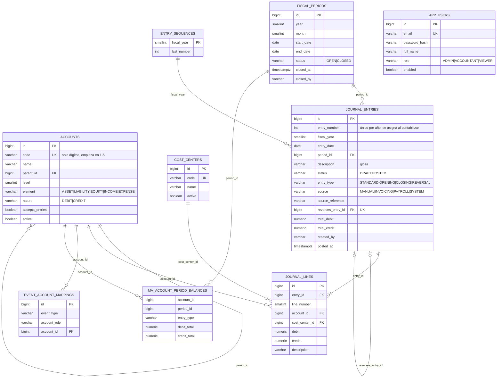
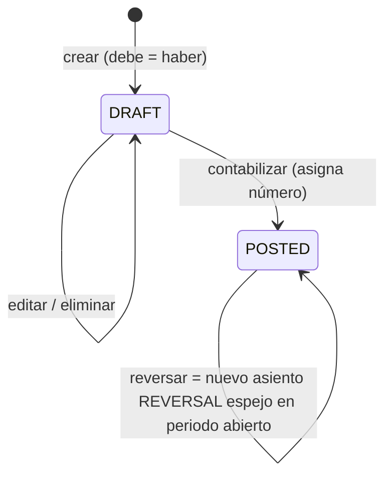

# Modelo de datos

Derivado de [investigacion.md](investigacion.md) (los números `#n` y `Rn` apuntan a esa tabla). Las tablas usan nombres en inglés; la equivalencia con el enunciado es:

| Enunciado | Tabla |
|---|---|
| plan_cuentas | `accounts` |
| periodos | `fiscal_periods` |
| asientos | `journal_entries` |
| lineas_asiento | `journal_lines` |
| centros_costo | `cost_centers` |
| saldos materializados por periodo | `mv_account_period_balances` (vista materializada) |



## Tablas, campos y restricciones

| Tabla | Campo | Tipo | Restricción | Regla / fuente |
|---|---|---|---|---|
| accounts | code | `VARCHAR(20)` | `UNIQUE`, `CHECK (code ~ '^[1-5][0-9]*$')` | R4 · #1, S1 |
| accounts | name | `VARCHAR(200)` | `NOT NULL` | #1 |
| accounts | parent_id | `BIGINT` | FK `accounts`; `NULL` ⇔ `level = 1` | R4 · #1 |
| accounts | level | `SMALLINT` | 1–10; trigger: `= nivel del padre + 1` | #1 |
| accounts | element | `VARCHAR(10)` | trigger: coincide con el primer dígito y con el padre | R4 · #1 |
| accounts | nature | `VARCHAR(6)` | `DEBIT`/`CREDIT` (las cuentas correctoras llevan la contraria) | R5 · #1 |
| accounts | accepts_entries | `BOOLEAN` | trigger: un padre no puede aceptar movimientos | R3 · #1 |
| cost_centers | code | `VARCHAR(20)` | `UNIQUE`, `^[A-Z0-9-]+$` | — |
| fiscal_periods | year, month | `SMALLINT` | `UNIQUE (year, month)`, mes 1–12 | S4 |
| fiscal_periods | start_date / end_date | `DATE` | `CHECK` primer y último día del mes | S4 |
| fiscal_periods | status | `VARCHAR(6)` | `OPEN`/`CLOSED`; trigger: `CLOSED` no vuelve a `OPEN` | R6 · #8 |
| journal_entries | entry_number | `INT` | `UNIQUE (fiscal_year, entry_number)`; `NOT NULL` ⇔ `POSTED` | numeración sin huecos al contabilizar |
| journal_entries | entry_date | `DATE` | trigger: dentro de `start_date..end_date` del periodo | — |
| journal_entries | total_debit / total_credit | `NUMERIC(18,2)` | `CHECK (total_debit = total_credit AND total_debit > 0)` | R1 · #10 |
| journal_entries | reverses_entry_id | `BIGINT` | FK, `UNIQUE` (un asiento se reversa una sola vez); `NOT NULL` ⇔ `REVERSAL` | R6 · #8 |
| journal_entries | source, source_reference | `VARCHAR` | `UNIQUE (source, source_reference)` → idempotencia de eventos | S6 |
| journal_lines | debit / credit | `NUMERIC(18,2)` | `>= 0` y `(debit > 0) <> (credit > 0)` | R2 · #10 |
| journal_lines | account_id | `BIGINT` | trigger: cuenta activa con `accepts_entries` | R3 |
| journal_lines | (entry) | — | `CONSTRAINT TRIGGER DEFERRABLE INITIALLY DEFERRED`: ≥ 2 líneas, Σ debe = Σ haber = totales de cabecera | R1 · #17 |
| journal_entries / lines | — | — | trigger: no se modifica ni borra nada de un asiento `POSTED` ni de un periodo `CLOSED` | R6 · #8 |
| app_users | email | `VARCHAR(254)` | `UNIQUE` (en minúsculas) | — |
| app_users | password_hash | `VARCHAR(100)` | BCrypt (coste 12) | OWASP #18 |

### Vista materializada `mv_account_period_balances`

```sql
SELECT l.account_id, e.period_id, e.entry_type,
       SUM(l.debit) AS debit_total, SUM(l.credit) AS credit_total
FROM journal_lines l JOIN journal_entries e ON e.id = l.entry_id
WHERE e.status = 'POSTED'
GROUP BY l.account_id, e.period_id, e.entry_type;
-- índice único (account_id, period_id, entry_type) → REFRESH ... CONCURRENTLY
```

Se refresca después del COMMIT de cada contabilización, reverso, cierre o evento (listener `AFTER_COMMIT`). La balanza de comprobación y los estados financieros leen de aquí; el libro diario y el mayor leen las tablas (necesitan el detalle).

### Estados del asiento



## Catálogos

- **Plan de cuentas base**: grupos del formulario de Supercias (#1) niveles 1–3 + cuentas de detalle usadas en la demo (S1, S2, S3, S5). Se carga con Flyway (`V2__seed_chart_of_accounts.sql`).
- **Mapeos de eventos** (`event_account_mappings`): `INVOICE_ISSUED` → `RECEIVABLE`, `SALES_REVENUE`, `SERVICE_REVENUE`, `VAT_PAYABLE`; `PAYROLL_ACCRUED` → `SALARY_EXPENSE`, `EMPLOYER_CONTRIBUTION_EXPENSE`, `BENEFITS_EXPENSE`, `SALARIES_PAYABLE`, `IESS_PAYABLE`, `BENEFITS_PAYABLE`.
- **Datos demo** (solo con `DEMO_DATA=true`): empresa ficticia "Comercial Andina Demo", periodos 2026, asiento de apertura, ventas, compras, nómina y un reverso. Sin datos personales reales.
